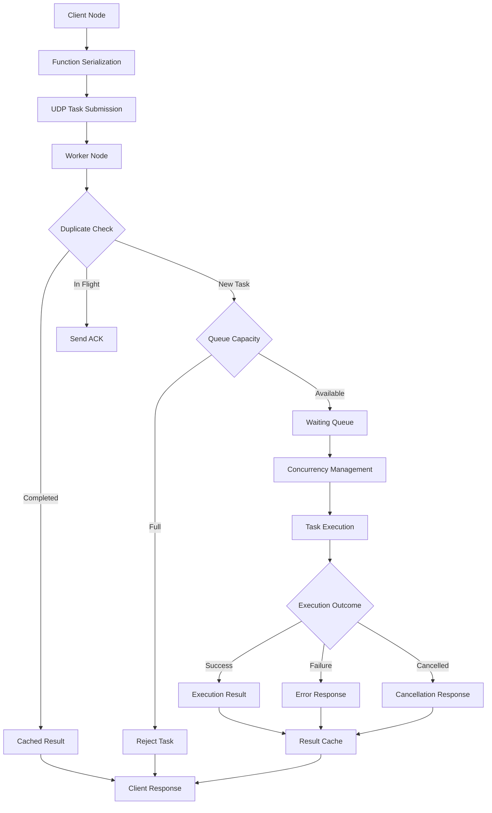
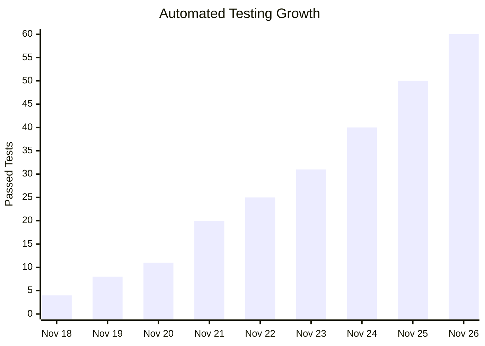

<div align="center">

# 🌐 MeshWeaver

### Zero-Dependency P2P Async Task Broker

**Distributed Systems & Edge Computing**


An asynchronous task execution broker designed to explore
remote function execution, concurrent task processing,
reliable communication, and distributed computing concepts.

</div>

---

## 📌 Project Overview

MeshWeaver is an educational asynchronous task broker
that enables a client to submit Python functions to a
worker for execution through UDP communication.

The project explores asynchronous networking, function
serialization, task scheduling, execution monitoring,
duplicate prevention, task cancellation, and graceful
worker shutdown.

The current implementation is a trusted-localhost
prototype developed using Python, asyncio, and cloudpickle.

> **Note:** Although the project title includes
> Zero-Dependency, the current prototype uses cloudpickle
> as an external dependency.

---

## 🎯 Project Objectives

- Establish communication between independent nodes.
- Implement asynchronous UDP networking.
- Serialize and transfer Python functions.
- Execute submitted functions on a worker.
- Return execution results to the client.
- Support concurrent task execution.
- Implement timeout and retry mechanisms.
- Prevent duplicate task execution.
- Monitor worker availability and task performance.
- Manage task queues and concurrency limits.
- Support task cancellation and graceful shutdown.

---

## 🛠️ Technology Stack

| Technology | Purpose |
|---|---|
| Python 3.13 | Core programming language |
| asyncio | Asynchronous execution |
| UDP | Network communication |
| cloudpickle | Function serialization |
| JSON | Message encoding |
| Base64 | Serialized payload encoding |
| UUID | Unique task identification |
| Logging | Execution monitoring |
| unittest | Automated testing |
| Git | Version control |
| GitHub | Repository collaboration |

---

## 🏗️ System Architecture



---

## ✨ Implemented Features

| Feature | Status |
|---|---|
| Basic UDP communication | Completed |
| Asynchronous UDP communication | Completed |
| Function serialization | Completed |
| Serialized function transfer | Completed |
| Remote function execution | Completed |
| Unique task identification | Completed |
| ACK response mechanism | Completed |
| Concurrent task execution | Completed |
| Timeout and retry handling | Completed |
| Remote error handling | Completed |
| Structured execution logging | Completed |
| Worker heartbeat monitoring | Completed |
| Task execution metrics | Completed |
| Duplicate task prevention | Completed |
| Completed result caching | Completed |
| Asynchronous waiting queue | Completed |
| Worker concurrency management | Completed |
| Queue capacity management | Completed |
| Local task cancellation | Completed |
| Graceful worker shutdown | Completed |
| Remote cancellation protocol | Completed |
| Client-side cancellation handling | Completed |
| Task lifecycle management | Completed |
| Task status retrieval | Completed |
| Dedicated cancellation metrics | Completed |
| Persistent task storage | Planned |
| Multi-worker scheduling | Planned |

---

## 📂 Project Structure

```text
MeshWeaver/
│
├── examples/
│   ├── sender.py
│   ├── receiver.py
│   ├── async_sender.py
│   ├── async_receiver.py
│   └── serialization_demo.py
│
├── meshweaver/
│   ├── broker.py
│   ├── demo.py
│   ├── logging_config.py
│   ├── metrics.py
│   └── task_state.py
│
├── tests/
│   ├── __init__.py
│   ├── test_broker.py
│   ├── test_logging.py
│   ├── test_health.py
│   ├── test_metrics.py
│   ├── test_deduplication.py
│   ├── test_queue.py
│   ├── test_cancellation.py
│   ├── test_remote_cancellation.py
│   └── test_task_state.py
│
├── docs/
│   ├── week1-progress.md
│   ├── nov18-progress.md
│   ├── nov22-progress.md
│   ├── nov23-progress.md
│   ├── nov24-progress.md
│   ├── nov25-progress.md
│   └── nov26-progress.md
│
├── .gitignore
├── requirements.txt
└── README.md
```

---

## 🚀 Installation and Setup

### 1. Clone the repository

```powershell
git clone https://github.com/Moulya-k-m/MeshWeaver.git
cd MeshWeaver
```

### 2. Switch to the development branch

```powershell
git checkout Ameesha
```

### 3. Create a virtual environment

```powershell
python -m venv venv
```

### 4. Activate the virtual environment

```powershell
.\venv\Scripts\Activate.ps1
```

### 5. Install dependencies

```powershell
pip install -r requirements.txt
```

If cloudpickle is not installed:

```powershell
pip install cloudpickle
```

### 6. Run the project demonstration

```powershell
python -m meshweaver.demo
```

### 7. Execute automated tests

```powershell
python -m unittest discover -s tests -v
```

---

# 📅 Daily Development Progress

## Week 1 — Networking and Serialization

<details>
<summary><b>Day 1 — Project Setup & Basic UDP Communication</b></summary>

### Date: 9 November 2026

#### Tasks Completed

- Created the Python virtual environment.
- Established the project folder structure.
- Configured .gitignore and requirements.txt.
- Studied UDP socket programming.
- Implemented a UDP sender and receiver.
- Established communication between Node A and Node B.
- Implemented ACK response handling.
- Resolved a UDP port conflict.

#### Files Created

- `examples/sender.py`
- `examples/receiver.py`

#### Test Result

Successfully transmitted a UDP message and received
an acknowledgement response.

**Status:** Completed

</details>

<details>
<summary><b>Day 2 — Asynchronous UDP Communication</b></summary>

### Date: 10 November 2026

#### Tasks Completed

- Studied Python asynchronous programming.
- Learned event loop fundamentals.
- Implemented asyncio.DatagramProtocol.
- Created asynchronous UDP sender and receiver.
- Established asynchronous datagram endpoints.
- Implemented ACK response handling.
- Added timeout handling using asyncio.wait_for().

#### Files Created

- `examples/async_sender.py`
- `examples/async_receiver.py`

#### Test Result

Successfully transmitted asynchronous UDP messages
and received acknowledgement responses.

**Status:** Completed

</details>

<details>
<summary><b>Day 3 — Function Serialization</b></summary>

### Date: 11 November 2026

#### Tasks Completed

- Studied serialization and deserialization.
- Implemented function serialization using cloudpickle.
- Converted Python functions into byte data.
- Restored serialized functions.
- Executed deserialized functions.

#### Files Created

- `examples/serialization_demo.py`

#### Test Result

| Parameter | Result |
|---|---|
| Serialization | Successful |
| Serialized data size | 563 bytes |
| Deserialization | Successful |
| Execution result | 1000 |

**Status:** Completed

</details>

<details>
<summary><b>Day 4 — Serialized Function Transfer</b></summary>

### Planned Date: 12 November 2026

### Completion: Integrated by 18 November 2026

#### Tasks Completed

- Serialized Python functions for transmission.
- Encoded serialized payloads using Base64.
- Transferred function data through UDP.
- Received and decoded task payloads.
- Deserialized received Python functions.

#### Test Result

Function transfer was verified as part of the
November 18 broker implementation.

**Status:** Completed

</details>

<details>
<summary><b>Day 5 — Basic Remote Function Execution</b></summary>

### Planned Date: 13 November 2026

### Completion: Integrated by 18 November 2026

#### Tasks Completed

- Executed received Python functions.
- Captured function execution results.
- Encoded execution results.
- Returned results to the client.
- Verified the remote execution workflow.

#### Test Result

Successfully executed submitted functions on the
localhost worker and returned execution results.

**Status:** Completed

</details>

---

## Week 2 — Broker Development and Reliability

<details>
<summary><b>Day 6 — Asynchronous Task Broker Development</b></summary>

### Date: 16 November 2026

#### Development Focus

- Asynchronous client and worker architecture.
- Task submission workflow.
- Unique task identification using UUID.
- UDP-based task message handling.
- Client and worker communication.

These features were integrated into the
November 18 broker prototype.

**Status:** Completed

</details>

<details>
<summary><b>Day 7 — Concurrent Task Execution</b></summary>

### Date: 17 November 2026

#### Development Focus

- Concurrent function execution.
- Asynchronous task scheduling.
- Synchronous and asynchronous function support.
- Result collection and response handling.

These features were integrated into the
November 18 broker prototype.

**Status:** Completed

</details>

<details>
<summary><b>Day 8 — Reliable Task Execution</b></summary>

### Date: 18 November 2026

#### Tasks Completed

- Implemented asynchronous task submission.
- Added unique task IDs.
- Implemented acknowledgement messages.
- Added timeout and retry handling.
- Implemented remote exception reporting.
- Added bounded completed-result caching.
- Created broker demonstration.
- Added automated broker tests.

#### Files Created or Updated

- `meshweaver/broker.py`
- `meshweaver/demo.py`
- `tests/test_broker.py`
- `docs/nov18-progress.md`

#### Test Result

4 automated tests passed.

**Status:** Completed

</details>

<details>
<summary><b>Day 9 — Structured Execution Logging</b></summary>

### Date: 19 November 2026

#### Tasks Completed

- Implemented structured logging.
- Added timestamp-based log formatting.
- Added task submission logs.
- Added execution and completion logs.
- Added warning and error messages.
- Prevented duplicate logging handlers.
- Added automated logging tests.

#### Files Created or Updated

- `meshweaver/logging_config.py`
- `meshweaver/broker.py`
- `tests/test_logging.py`

#### Test Result

8 automated tests passed.

**Status:** Completed

</details>

<details>
<summary><b>Day 10 — Worker Heartbeat and Health Monitoring</b></summary>

### Date: 20 November 2026

#### Tasks Completed

- Implemented PING and PONG messages.
- Added worker availability checks.
- Implemented heartbeat timeout handling.
- Added health-check logging.
- Verified healthy and unavailable worker scenarios.
- Added automated health-check tests.

#### Files Created or Updated

- `meshweaver/broker.py`
- `tests/test_health.py`

#### Test Result

11 automated tests passed.

**Status:** Completed

</details>

---

## Week 3 — Monitoring and Worker Management

<details>
<summary><b>Day 11 — Task Execution Metrics</b></summary>

### Date: 21 November 2026

#### Tasks Completed

- Implemented task execution metrics.
- Tracked total submitted tasks.
- Tracked successful and failed tasks.
- Tracked pending tasks.
- Recorded retry and timeout counts.
- Calculated average execution duration.
- Calculated task success rate.
- Added automated metrics tests.

#### Files Created or Updated

- `meshweaver/metrics.py`
- `meshweaver/broker.py`
- `meshweaver/demo.py`
- `tests/test_metrics.py`

#### Test Result

20 automated tests passed.

**Status:** Completed

</details>

<details>
<summary><b>Day 12 — Duplicate Task Prevention</b></summary>

### Date: 22 November 2026

#### Tasks Completed

- Implemented in-flight task tracking.
- Prevented duplicate task execution.
- Added duplicate packet monitoring.
- Preserved completed task results.
- Implemented cached response handling.
- Verified task tracking cleanup.
- Added five automated deduplication tests.

#### Files Created or Updated

- `meshweaver/broker.py`
- `meshweaver/demo.py`
- `tests/test_deduplication.py`
- `docs/nov22-progress.md`

#### Test Result

| Parameter | Result |
|---|---|
| Automated tests | 25 passed |
| Duplicate packets handled | 2 |
| Retry count | 2 |
| Task result | 49 |
| Active tasks after completion | 0 |

**Status:** Completed

</details>

<details>
<summary><b>Day 13 — Async Task Queue & Concurrency Management</b></summary>

### Date: 23 November 2026

#### Tasks Completed

- Implemented an asynchronous waiting queue.
- Added configurable worker concurrency limits.
- Implemented maximum queue capacity.
- Added queue-full rejection handling.
- Implemented waiting and running task monitoring.
- Added maximum observed concurrency tracking.
- Preserved duplicate task protection.
- Added six automated queue tests.

#### Files Created or Updated

- `meshweaver/broker.py`
- `tests/test_queue.py`
- `tests/__init__.py`
- `docs/nov23-progress.md`

#### Configuration

| Parameter | Default Value |
|---|---|
| Maximum concurrent tasks | 2 |
| Maximum waiting tasks | 100 |
| Completed result cache | 256 |

#### Test Result

| Parameter | Result |
|---|---|
| Automated tests | 31 passed |
| Execution time | 3.370 seconds |
| Test failures | 0 |

**Status:** Completed

</details>

<details>
<summary><b>Day 14 — Task Cancellation & Graceful Worker Shutdown</b></summary>

### Date: 24 November 2026

#### Tasks Completed

- Implemented task ID to asyncio task mapping.
- Added queued task cancellation.
- Added running asynchronous task cancellation.
- Implemented cancellation before execution.
- Added cancelled-result caching.
- Implemented cancellation statistics.
- Added task tracking cleanup.
- Implemented graceful worker shutdown.
- Added rejection of new tasks during shutdown.
- Preserved existing concurrency management.
- Added nine automated cancellation tests.
- Updated the live demonstration.

#### Files Created or Updated

- `meshweaver/broker.py`
- `meshweaver/demo.py`
- `tests/test_cancellation.py`
- `docs/nov24-progress.md`

#### Automated Test Results

| Parameter | Result |
|---|---|
| Existing tests | 31 passed |
| New tests | 9 passed |
| Total automated tests | 40 passed |
| Execution time | 3.618 seconds |
| Test failures | 0 |

#### Live Demo Results

| Feature | Result |
|---|---|
| Worker health | HEALTHY |
| Concurrent task results | 25, 100, 625 |
| Duplicate packets handled | 2 |
| Retry count | 2 |
| Cancellation successful | True |
| Cancelled tasks | 1 |
| Active tasks | 0 |
| Graceful shutdown | True |
| Remaining tasks | 0 |

**Status:** Implementation and testing completed

</details>

---


<details>
<summary><b>Day 15 - Remote Task Cancellation & Client-Side Cancellation Handling</b></summary>

### Date: 25 November 2026

#### Tasks Completed

- Implemented UDP cancellation requests and acknowledgements.
- Added client-side cancellation API.
- Added active task ID retrieval.
- Implemented cancellation retries and timeout handling.
- Added task owner address validation.
- Implemented duplicate cancellation handling.
- Improved cancellation caching and shutdown scheduling.
- Added ten automated remote cancellation tests.
- Updated the live demonstration.

#### Files Updated

- meshweaver/broker.py
- meshweaver/demo.py
- tests/test_remote_cancellation.py
- docs/nov25-progress.md

#### Test Results

| Parameter | Result |
|---|---|
| Existing tests | 40 passed |
| New tests | 10 passed |
| Total tests | 50 passed |
| Execution time | 5.731 seconds |
| Test failures | 0 |
| Pass rate | 100% |

#### Live Demo Results

| Feature | Result |
|---|---|
| Cancellation ACK | True |
| Cancellation successful | True |
| Cancelled tasks | 1 |
| Active tasks | 0 |
| Graceful shutdown | True |
| Remaining tasks | 0 |

**Implementation Commit:** b0c5a89

**Status:** Completed

</details>

---


<details open>
<summary><b>Day 16 - Task Lifecycle Management and Dedicated Cancellation Metrics</b></summary>

### Date: 26 November 2026

#### Tasks Completed

- Implemented TaskState enumeration.
- Implemented TaskRegistry lifecycle management.
- Added valid task state transitions.
- Added UTC lifecycle timestamps.
- Implemented bounded task history.
- Added worker task status retrieval.
- Added task state distribution reporting.
- Separated cancelled tasks from failed tasks.
- Added cancellation request statistics.
- Verified unauthorized cancellation rejection.
- Verified simulated cancellation ACK loss recovery.
- Added 10 automated tests.
- Updated the live demonstration.

#### Task Lifecycle

SUBMITTED -> QUEUED -> RUNNING

Terminal states:

- COMPLETED
- FAILED
- CANCELLED

Queued tasks can also be cancelled before execution.

#### Files Created

- meshweaver/task_state.py
- tests/test_task_state.py
- docs/nov26-progress.md

#### Files Updated

- meshweaver/broker.py
- meshweaver/metrics.py
- meshweaver/demo.py

#### Automated Test Results

| Parameter | Result |
|---|---|
| Existing tests | 50 passed |
| New tests | 10 passed |
| Total tests | 60 passed |
| Execution time | 7.393 seconds |
| Test failures | 0 |
| Pass rate | 100% |

#### Live Demo Results

| Metric | Result |
|---|---|
| Submitted tasks | 6 |
| Successful tasks | 4 |
| Failed tasks | 1 |
| Cancelled tasks | 1 |
| Pending tasks | 0 |
| Retries | 2 |
| Timeouts | 2 |
| Average duration | 0.060543 seconds |
| Success rate | 66.67% |
| Cancellation rate | 16.67% |
| Cancellation requests | 1 |
| Cancellation accepted | 1 |
| Remaining worker tasks | 0 |

#### Current Limitations

- Task history is stored in memory.
- Terminal history is limited to 256 records.
- Status retrieval uses the local Worker API.
- ACK packet loss testing is simulated.
- Cancellation logging requires refinement.
- Trusted localhost prototype only.

**Implementation Commit:** b164346

**Status:** Completed

</details>

---

## 📊 Automated Testing Progress

| Date | Testing Module | New Tests | Total Passed |
|---|---|---:|---:|
| Nov 18 | Broker | 4 | 4 |
| Nov 19 | Logging | 4 | 8 |
| Nov 20 | Health Monitoring | 3 | 11 |
| Nov 21 | Metrics | 9 | 20 |
| Nov 22 | Duplicate Prevention | 5 | 25 |
| Nov 23 | Queue Management | 6 | 31 |
| Nov 24 | Cancellation and Shutdown | 9 | 40 |
| Nov 25 | Remote Cancellation | 10 | 50 |
| Nov 26 | Task Lifecycle and Metrics | 10 | 60 |



### Latest Test Execution

```text
Ran 60 tests in 7.393s

OK
```

| Test Module | Tests | Status |
|---|---:|---|
| Broker | 4 | Passed |
| Logging | 4 | Passed |
| Health Monitoring | 3 | Passed |
| Metrics | 9 | Passed |
| Deduplication | 5 | Passed |
| Queue Management | 6 | Passed |
| Cancellation | 9 | Passed |
| Remote Cancellation | 10 | Passed |
| Task Lifecycle and Cancellation Metrics | 10 | Passed |
| **Total** | **60** | **Passed** |

---

## 🔄 Development Roadmap

- [x] Project environment setup
- [x] UDP communication
- [x] Asynchronous networking
- [x] Function serialization
- [x] Remote function execution
- [x] Concurrent task processing
- [x] Timeout and retry handling
- [x] Structured logging
- [x] Worker health monitoring
- [x] Task execution metrics
- [x] Duplicate task prevention
- [x] Queue and concurrency management
- [x] Local task cancellation
- [x] Graceful worker shutdown
- [x] Remote cancellation protocol
- [x] Client-side cancellation handling
- [x] Task lifecycle management
- [x] Task status retrieval
- [x] Dedicated cancellation metrics
- [x] Simulated cancellation ACK loss testing
- [ ] Shutdown timeout management
- [ ] Persistent task storage
- [ ] Multi-worker task scheduling
- [ ] Extended integration testing
- [ ] Final project documentation

---

## ⚠️ Current Limitations

- The prototype is restricted to trusted localhost use.
- cloudpickle is an external dependency.
- Untrusted serialized payloads must never be deserialized.
- UDP does not guarantee message delivery.
- Task queues and result caches are stored in memory.
- Task state is lost after a worker restart.
- Duplicate prevention is limited to individual workers.
- Remote cancellation is supported over trusted localhost UDP.
- Address validation is not cryptographic authentication.
- Cancellation timeout does not prove cancellation failed.
- Running synchronous threads cannot be forcibly cancelled.
- Async cancellation requires cooperative coroutines.
- Shutdown may wait indefinitely for non-terminating tasks.
- Multi-worker scheduling is not yet implemented.
- Production-level security and authentication are not implemented.

---

## 📚 Development Documentation

- [Week 1 Progress](docs/week1-progress.md)
- [November 18 Progress](docs/nov18-progress.md)
- [November 22 Progress](docs/nov22-progress.md)
- [November 23 Progress](docs/nov23-progress.md)
- [November 24 Progress](docs/nov24-progress.md)
- [November 25 Progress](docs/nov25-progress.md)
- [November 26 Progress](docs/nov26-progress.md)

---

## 👩‍💻 Contributor Information

| Information | Details |
|---|---|
| Contributor | Gade Ameesha |
| Role | Python Development Intern |
| Organization | Infotact Solutions |
| Project | MeshWeaver |
| Domain | Distributed Systems & Edge Computing |
| Development Branch | Ameesha |
| Latest Development Day | Day 16 |
| Automated Tests Passed | 60 |

### Contributions

- Python application development
- Asynchronous network programming
- Task execution and worker management
- Reliability and error handling
- Automated testing
- Technical documentation

[](https://github.com/GadeAmeesha)
[](https://www.linkedin.com/in/gade-ameesha/)

---

<div align="center">

### 🌐 MeshWeaver

**Asynchronous Networking • Reliable Execution • Distributed Computing**

Developed as part of the Infotact Solutions
Python Development Internship.

**Project Status: Active Development**

**Last Updated: 26 November 2026**

</div>
