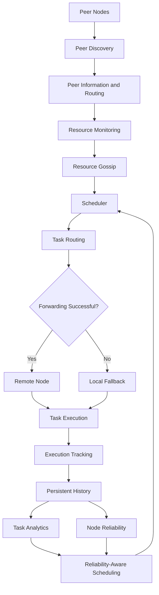

 <div align="center">

# 🕸️ MeshWeaver

### Zero-Dependency P2P Async Task Broker

**Distributed Systems & Edge Computing**


A decentralized peer-to-peer asynchronous task broker exploring distributed communication, peer discovery, resource monitoring, load-aware scheduling, routing reliability and execution analytics.

</div>

---

## 📌 Project Overview

MeshWeaver is a decentralized peer-to-peer asynchronous task broker developed using Python. It aims to distribute tasks across multiple nodes without depending on centralized message brokers such as Redis or RabbitMQ.

The project explores asynchronous UDP/TCP communication, peer discovery, resource gossip, distributed scheduling, task execution monitoring, node reliability and failure handling.

It is being developed incrementally, with individual modules and automated tests for different distributed-system components.

> **Note:** MeshWeaver is an ongoing development project. Some components currently operate as independently tested modules and are not yet integrated into the complete live node runtime.

---

## 🎯 Project Objectives

- Establish communication between independent nodes.
- Implement asynchronous UDP and TCP networking.
- Develop peer discovery and routing mechanisms.
- Exchange CPU, RAM and active-task information.
- Implement resource-aware task scheduling.
- Monitor peer availability and resource-report freshness.
- Handle forwarding failures and local execution fallback.
- Track task execution and maintain persistent history.
- Analyse task performance and node reliability.
- Develop reliability-aware scheduling decisions.
- Validate components through automated and multi-node testing.

---

## 🛠️ Technology Stack

| Technology | Purpose |
|---|---|
| Python | Core programming language |
| asyncio | Asynchronous communication |
| UDP | Peer communication and discovery |
| TCP | Reliable message exchange |
| JSON | Structured message encoding |
| cloudpickle | Python object serialization |
| HMAC-SHA256 | Message authentication |
| SHA-1 | Node identifier generation |
| JSONL | Execution and routing history |
| pytest | Automated testing |
| Git | Version control |
| GitHub | Repository collaboration |

---

## 🏗️ System Architecture

The following diagram represents the intended high-level MeshWeaver workflow. Individual components are being developed and integrated incrementally.



---

## ✨ Implemented Features

| Feature | Status |
|---|---|
| UDP communication | Completed |
| TCP communication | Completed |
| TCP message framing | Completed |
| Node identity generation | Completed |
| Peer information management | Completed |
| Peer routing table | Completed |
| Bootstrap-based peer discovery | Completed |
| FIND_NODE lookup | Completed |
| Resource monitoring | Completed |
| CPU and RAM reporting | Completed |
| Asynchronous resource gossip | Completed |
| Stale resource-report validation | Completed |
| Authenticated resource reports | Completed |
| Scheduler load updates | Completed |
| Dead-peer detection and cleanup | Completed |
| Three-node integration testing | Completed |
| Routing decision logging | Completed |
| Failed-forwarding local fallback | Completed |
| Task lifecycle tracking | Completed |
| Persistent JSONL execution history | Completed |
| Task execution analytics | Completed |
| Node reliability monitoring | Completed |
| Node health classification | Completed |
| Reliability-aware node ranking | Completed |
| Live integration of Day 19 scheduler | Planned |
| Large-scale cluster stress testing | Planned |

---

## 📂 Project Structure

```text
MeshWeaver/
│
├── day1_wk1/
│   ├── sender.py
│   ├── listener.py
│   └── README.md
│
├── day2_wk1/
│   ├── framing.py
│   ├── tcp_client.py
│   ├── tcp_server.py
│   └── README.md
│
├── day3_wk1/
│   ├── discovery.py
│   ├── peer_table.py
│   ├── task_queue.py
│   ├── framing.py
│   ├── node.py
│   ├── cluster_test.py
│   ├── test_peer_table.py
│   ├── test_task_recovery.py
│   └── README.md
│
├── day4_wk1/
│   ├── node.py
│   ├── resource_monitor.py
│   ├── resource_gossip.py
│   ├── scheduler.py
│   ├── task_store.py
│   ├── worker.py
│   └── README.md
│
├── day5_wk1/
│   ├── discovery.py
│   ├── peer_table.py
│   ├── framing.py
│   ├── node.py
│   ├── resource_monitor.py
│   ├── resource_gossip.py
│   ├── scheduler.py
│   ├── worker.py
│   ├── task_store.py
│   ├── journal.py
│   ├── security.py
│   ├── cluster_test.py
│   ├── test_journal.py
│   ├── test_task_recovery.py
│   ├── dashboard.py
│   ├── web_dashboard.py
│   ├── test_resource_gossip_day12_13.py
│   └── README.md
│
├── day6_wk1/
│   ├── recovery_audit.py
│   ├── test_recovery.py
│   ├── test_journal_integrity.py
│   ├── test_recovery_report.py
│   ├── test_node_recovery.py
│   └── README.md
│
├── day7_wk1/
│   ├── serializer.py
│   ├── test_serialization.py
│   ├── test_worker.py
│   ├── test_remote_execution.py
│   ├── test_load_balance.py
│   └── README.md
│
├── day8_wk2/
│   ├── node_identity.py
│   ├── peer_info.py
│   ├── test_day8.py
│   ├── test_edge_cases.py
│   ├── test_serialization.py
│   └── README.md
│
├── day9_wk2/
│   ├── __init__.py
│   ├── peer.py
│   ├── routing_table.py
│   ├── test_routing.py
│   └── README.md
│
├── day10_wk2/
│   ├── __init__.py
│   ├── bootstrap.py
│   ├── peer_discovery.py
│   ├── test_discovery.py
│   └── README.md
│
├── day11_wk2/
│   ├── __init__.py
│   ├── find_node.py
│   ├── test_find_node.py
│   ├── lookup_manager.py
│   ├── test_lookup_manager.py
│   └── README.md
│
├── day12_day13_wk2/
│   └── README.md
│
├── day14_wk2/
│   ├── __init__.py
│   ├── integration.py
│   ├── test_integration.py
│   ├── test_real_cluster.py
│   └── README.md
│
├── day15_wk3/
│   ├── routing_logger.py
│   ├── test_routing_reliability.py
│   ├── routing_logs/
│   └── README.md
│
├── day16_wk3/
│   ├── execution_tracker.py
│   ├── test_execution_tracker.py
│   └── README.md
│
├── day17_wk3/
│   ├── task_analytics.py
│   ├── test_task_analytics.py
│   ├── run_analytics.py
│   └── README.md
│
├── day18_wk3/
│   ├── node_reliability.py
│   ├── test_node_reliability.py
│   ├── run_reliability.py
│   ├── generate_demo_history.py
│   └── README.md
│
├── day19_wk3/
│   ├── __init__.py
│   ├── reliability_scheduler.py
│   └── test_reliability_scheduler.py
│
├── .gitignore
├── README.md
└── requirements.txt
```

---

## 🚀 Installation and Setup

### 1. Clone the repository

```powershell
git clone https://github.com/Moulya-k-m/MeshWeaver.git
cd MeshWeaver
```

### 2. Switch to the development branch

```powershell
git checkout Navya
```

### 3. Create a virtual environment

```powershell
py -m venv .venv
```

### 4. Activate the virtual environment

```powershell
.\.venv\Scripts\Activate.ps1
```

### 5. Install dependencies

```powershell
pip install -r requirements.txt
```

---

# 📅 Daily Development Progress

## Week 1 — Communication and Core Foundations

<details>
<summary><strong>Day 1 — UDP Communication</strong></summary>

**Tasks Completed**

- Implemented UDP sender and listener.
- Established PING/PONG communication.
- Added JSON-based message exchange.
- Generated unique node IDs using UUID and SHA-1.
- Added configurable message count and timeout.
- Implemented RTT measurements: minimum, average and maximum.
- Added malformed packet handling.

**Files:** `sender.py`, `listener.py`

**Result:** Successfully established basic UDP communication between nodes.

**Status:** Completed

</details>

<details>
<summary><strong>Day 2 — TCP Communication and Message Framing</strong></summary>

**Tasks Completed**

- Implemented TCP client and server.
- Developed four-byte big-endian message framing.
- Added a maximum message size of 1 MB.
- Implemented HELLO and HELLO_ACK messages.
- Added ADD and TIME operations.
- Implemented handling for unknown operations.

**Files:** `framing.py`, `tcp_client.py`, `tcp_server.py`

**Result:** Established reliable TCP communication with structured message framing.

**Status:** Completed

</details>

<details>
<summary><strong>Days 3–7 — Core Node Development</strong></summary>

**Development Focus**

- Peer discovery and peer table foundations.
- Task queue and node communication.
- Resource monitoring and resource gossip.
- Scheduler and task storage.
- Worker implementation.
- Recovery and journal-related components.
- Function serialization and remote execution foundations.
- Automated tests for peer management, recovery, serialization and worker functionality.

**Status:** Completed development foundations

</details>

## Week 2 — Peer Discovery and Resource Coordination

<details>
<summary><strong>Day 8 — Node Identity and Peer Information</strong></summary>

**Tasks Completed**

- Developed node identity management.
- Implemented peer information representation.
- Added node metadata handling.
- Tested edge cases and serialization.

**Files:** `node_identity.py`, `peer_info.py`

**Status:** Completed

</details>

<details>
<summary><strong>Day 9 — Peer Representation and Routing Table</strong></summary>

**Tasks Completed**

- Implemented peer representation.
- Developed routing table foundations.
- Added peer management and routing tests.
- Introduced Kademlia-style routing concepts.

**Files:** `peer.py`, `routing_table.py`

**Status:** Completed

</details>

<details>
<summary><strong>Day 10 — Bootstrap and Peer Discovery</strong></summary>

**Tasks Completed**

- Implemented bootstrap server.
- Added peer registration.
- Developed peer discovery.
- Established TCP-based peer information exchange.
- Added discovery tests.

**Files:** `bootstrap.py`, `peer_discovery.py`

**Status:** Completed

</details>

<details>
<summary><strong>Day 11 — FIND_NODE and Lookup Manager</strong></summary>

**Tasks Completed**

- Implemented FIND_NODE functionality.
- Developed lookup manager.
- Added peer lookup operations.
- Integrated lookup with routing information.
- Added automated tests for lookup and discovery.

**Files:** `find_node.py`, `lookup_manager.py`

**Status:** Completed

</details>

<details>
<summary><strong>Days 12–13 — Resource Gossip and Monitoring</strong></summary>

**Tasks Completed**

- Implemented CPU and RAM resource reporting.
- Added active task count reporting.
- Developed asynchronous resource exchange.
- Added timestamp validation.
- Rejected stale resource reports.
- Updated scheduler load information.
- Added resource cleanup for outdated peer information.
- Validated incoming resource reports.

**Files:** Resource gossip implementation under `day5_wk1`, with Day 12–13 documentation and tests.

**Status:** Completed

</details>

<details>
<summary><strong>Day 14 — Discovery and Gossip Integration</strong></summary>

**Tasks Completed**

- Developed discovery and gossip integration coordinator.
- Integrated peer registration and resource exchange.
- Added authenticated TCP resource reports.
- Updated scheduler load information.
- Implemented dead-peer cleanup.
- Excluded bootstrap nodes from resource gossip.
- Added three-node cluster integration testing.

**Three-Node Cluster Validation**

- Started three independent nodes.
- Verified peer discovery.
- Exchanged authenticated resource reports.
- Updated scheduler resource information.
- Stopped one node and detected its failure.
- Removed stale peer resource information.
- Gracefully shut down remaining nodes.

**Test Results**

| Test Suite | Passed |
|---|---:|
| Integration | 3 |
| Resource Gossip | 7 |
| Discovery | 4 |
| Lookup Manager | 5 |
| FIND_NODE | 4 |
| **Total** | **23** |

**Execution Result:** 23 passed in 10.90 seconds.

**Status:** Completed

</details>

## Week 3 — Routing Reliability and Distributed Execution

<details>
<summary><strong>Day 15 — Routing Reliability and Decision Logging</strong></summary>

**Tasks Completed**

- Added stale resource-report validation.
- Prevented routing using outdated peer information.
- Implemented forwarding failure detection.
- Added local fallback when forwarding fails.
- Developed `RoutingDecisionLogger`.
- Implemented structured JSONL routing logs.

**Routing Log Information**

- Timestamp and task ID.
- Node ID.
- Routing decision.
- Decision reason.
- Local load score.
- Selected peer ID and peer score.

**Supported Decisions**

- `FORWARDED`
- `LOCAL`

**Files:** `routing_logger.py`, `test_routing_reliability.py`

**Test Result:** 2 passed in 0.13 seconds.

**Status:** Completed

</details>

<details>
<summary><strong>Day 16 — Task Execution Tracking and Persistent History</strong></summary>

**Tasks Completed**

- Developed `ExecutionTracker`.
- Implemented task lifecycle tracking.
- Added SUBMITTED, ASSIGNED, COMPLETED and FAILED states.
- Added task submission and assignment methods.
- Implemented completion and failure recording.
- Added task status retrieval.
- Implemented JSONL-based persistent event storage.
- Added history restoration using `load_history()`.
- Added handling for corrupted history entries.
- Implemented terminal-state validation.

**Files:** `execution_tracker.py`, `test_execution_tracker.py`

**Status:** Completed

</details>

<details>
<summary><strong>Day 17 — Task Execution Analytics</strong></summary>

**Tasks Completed**

- Developed `TaskAnalytics`.
- Implemented JSONL execution history loading.
- Added overall task summaries.
- Calculated completed, failed and pending task counts.
- Calculated execution success rate.
- Implemented node-wise execution statistics.
- Added average task duration calculation.
- Added handling for missing and corrupted history.
- Developed a command-line analytics runner.

**Files**

- `task_analytics.py`
- `test_task_analytics.py`
- `run_analytics.py`

**Test Result:** 8 passed in 0.17 seconds.

**Status:** Completed

</details>

<details>
<summary><strong>Day 18 — Node Reliability Monitoring</strong></summary>

**Tasks Completed**

- Developed `NodeReliability`.
- Implemented node-wise completed and failed task statistics.
- Calculated historical success rates.
- Calculated average task duration.
- Added node health classification.
- Implemented reliability-based node ranking.
- Added minimum task-history requirements.
- Developed a reliability report runner.
- Generated demonstration execution history.

**Node Health Classification**

| Health | Condition |
|---|---|
| HEALTHY | Success rate ≥ 90% |
| WARNING | Success rate ≥ 70% and below 90% |
| CRITICAL | Success rate below 70% |
| INSUFFICIENT_DATA | Fewer than 5 tasks |

**Demonstration Data**

Generated 16 sample tasks and 48 execution events across four nodes.

| Node | Completed | Failed | Success Rate | Health |
|---|---:|---:|---:|---|
| node-A | 5 | 0 | 100% | HEALTHY |
| node-B | 4 | 1 | 80% | WARNING |
| node-C | 2 | 3 | 40% | CRITICAL |
| node-D | 1 | 0 | 100% | INSUFFICIENT_DATA |

**Files**

- `node_reliability.py`
- `test_node_reliability.py`
- `run_reliability.py`
- `generate_demo_history.py`

**Test Result:** 8 passed in 0.30 seconds.

**Status:** Completed

</details>

<details>
<summary><strong>Day 19 — Reliability-Aware Adaptive Scheduling</strong></summary>

**Objective**

Develop a scheduling decision engine that considers not only current node resources but also historical node reliability and execution performance.

**Tasks Completed**

- Developed `ReliabilityAwareScheduler`.
- Combined historical reliability with current resource availability.
- Added CPU availability scoring.
- Added RAM availability scoring.
- Added historical task-duration performance scoring.
- Implemented weighted node ranking.
- Excluded dead nodes.
- Excluded nodes with stale resource reports.
- Added neutral reliability scoring for nodes with insufficient history.
- Added neutral performance scoring when history is unavailable.
- Added validation for malformed resource values and invalid active task counts.
- Implemented deterministic ranking and tie-breaking.
- Added human-readable scheduling decision explanations.

**Scoring Model**

| Factor | Weight |
|---|---:|
| Historical reliability | 50% |
| CPU availability | 25% |
| RAM availability | 15% |
| Execution performance | 10% |

**Files Created**

- `reliability_scheduler.py`
- `test_reliability_scheduler.py`
- `__init__.py`

**Test Coverage**

- Dead-node exclusion.
- Stale-report exclusion.
- Invalid CPU and RAM values.
- Invalid reliability information.
- New nodes with insufficient history.
- Missing execution performance information.
- Node ranking and selection.
- Reliability-based selection.
- Decision explanation generation.
- Invalid active task counts.

**Automated Test Result**

```text
13 passed in 0.06s
```

**Status:** Completed

**Current Scope:** The module is an independently tested scheduling decision engine. Integration with the live PeerTable, existing Scheduler and Node runtime is still pending.

</details>

---

## 📊 Automated Testing Summary

| Module | Verified Tests |
|---|---:|
| Day 14 Integration | 3 passed |
| Day 15 Routing Reliability | 2 passed |
| Day 17 Task Analytics | 8 passed |
| Day 18 Node Reliability | 8 passed |
| Day 19 Reliability Scheduler | 13 passed |

**Day 19 latest test execution:**

```text
13 passed in 0.06s
```

*The results above come from separate test executions. They are not a single combined regression run.*

---

## 🧪 Running Tests

Install project dependencies:

```powershell
pip install -r requirements.txt
```

**Day 14 – Integration Tests**

```powershell
pytest day14_wk2 -v
```

**Day 14 – Real Cluster Test**

```powershell
pytest day14_wk2/test_real_cluster.py -v -s
```

**Week 2 – Combined Regression Tests**

```powershell
pytest day14_wk2 day5_wk1/test_resource_gossip_day12_13.py day10_wk2/test_discovery.py day11_wk2/test_lookup_manager.py day11_wk2/test_find_node.py -v
```

**Day 15 – Routing Reliability**

```powershell
pytest day15_wk3 -v
```

**Day 16 – Execution Tracking**

```powershell
pytest day16_wk3 -v
```

**Day 17 – Task Analytics**

```powershell
pytest day17_wk3 -v
python day17_wk3/run_analytics.py
```

**Day 18 – Node Reliability**

```powershell
pytest day18_wk3/test_node_reliability.py -v
```

**Day 19 – Reliability-Aware Scheduling**

```powershell
python -m pytest day19_wk3/test_reliability_scheduler.py -v
```

---

## ⚠️ Current Limitations

- Newer TCP-based discovery components and the existing Node runtime's UDP discovery are not fully unified.
- Day 14 integration coordinator is not yet wired into the complete `Node.run()` lifecycle.
- Large-scale multi-node testing is pending.
- Simultaneous peer failures and task recovery need further validation.
- Day 16 execution tracking requires integration with the complete distributed execution pipeline.
- Day 17 analytics depends on available execution history.
- Day 18 reliability monitoring currently analyses historical events independently.
- Day 18 demonstration data is generated sample data, not live cluster measurements.
- Day 19 scheduler is not yet integrated with the live PeerTable, Scheduler or Node runtime.
- Cloudpickle deserialization should only be used with trusted peers.
- End-to-end task execution and failure recovery require further integration testing.

---

## 🔄 Development Roadmap

- [x] Basic UDP communication
- [x] TCP communication and message framing
- [x] Node identity and peer management
- [x] Peer discovery and lookup
- [x] Resource monitoring and gossip
- [x] Authenticated resource reports
- [x] Three-node integration testing
- [x] Routing reliability and local fallback
- [x] Task execution tracking
- [x] Persistent execution history
- [x] Task analytics
- [x] Node reliability monitoring
- [x] Reliability-aware scheduling decision engine
- [ ] Integrate Day 19 scheduler with the live node runtime
- [ ] Integrate execution tracking with distributed task processing
- [ ] Implement further task failure recovery and reassignment
- [ ] Validate scheduling across multiple live nodes
- [ ] Perform larger-scale stress testing
- [ ] Expand end-to-end integration testing

---

## 👩‍💻 Development Information

| Information | Details |
|---|---|
| Project | MeshWeaver |
| Organization | Infotact Solutions |
| Domain | Distributed Systems & Edge Computing |
| Language | Python |
| Architecture | Peer-to-Peer |
| Development Branch | Navya |
| Latest Development Day | Day 19 |
| Repository | [MeshWeaver on GitHub](https://github.com/Moulya-k-m/MeshWeaver) |

---

<div align="center">

### 🕸️ MeshWeaver

**Decentralized Communication • Reliable Routing • Intelligent Scheduling**

Developed as part of the Infotact Solutions internship project.

**Project Status: Active Development**

**Latest Development: Day 19**

</div>